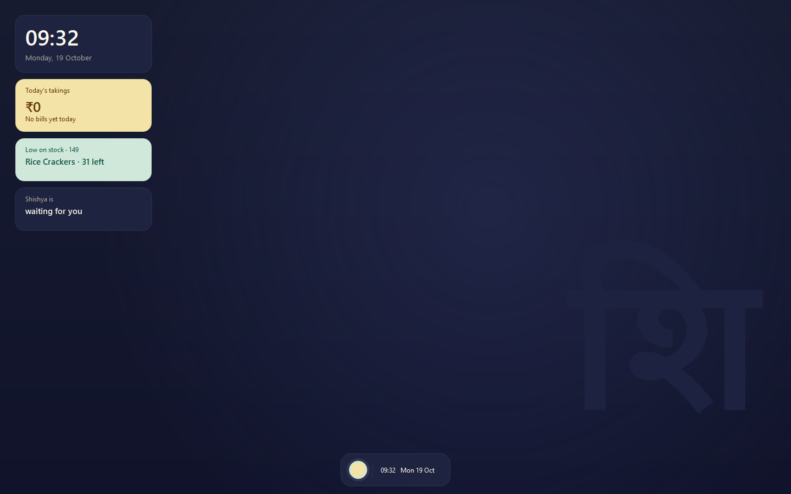
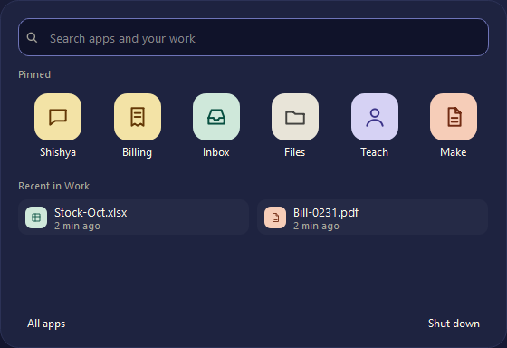
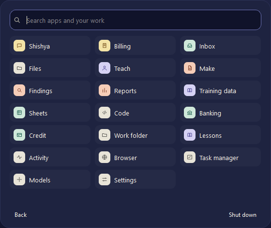

# The clone's desktop: design guide

*"The apprentice's desk."* The screen Shishya works on, and the one you take over when you have the wheel. The code is in `clone/desktop.py`; window chrome is in `clone/kit.py`.

## The idea

The home page is the counter: warm, paper-like, calm. The clone's screen is the desk behind it, where the apprentice works. The two must read as one product. They share the same tints, the same icons and the same plain words. Only the light changes: the desk is in deep ink, so the work on it stands out.

Three rules decide everything else:

1. **Every pixel tells the truth.** Nothing on the desk is decoration pretending to be data. There are no weather or news widgets: the sandbox has no network, so they would be fake. Cards show the shop's own books and what Shishya is doing.
2. **Less to look at, never less you can do.** The desk shows six apps. Everything else is one click away, under **All apps** or the search field.
3. **Calm by default.** Nothing moves unless it means something. The only motion is the orb, and only while Shishya works or needs you.

## Layout

The screen is 1440 × 900 points, always. Lessons depend on that layout, so it never changes size. On a high-DPI display it is drawn with more pixels, not at a bigger size.

| Region | Where | What |
| --- | --- | --- |
| Cards | Left column, x 28, 248 wide, from the top | Clock, today's takings, stock, what Shishya is doing |
| The mark | Bottom right | शि, very large, barely lighter than the ink |
| Dock | Bottom centre, floating 14 pt above the edge, 60 tall | Orb · open windows · time |
| Start panel | Centred above the dock | Search, pinned apps, recent work |
| Apps | Anywhere above the bottom 88 pt | App windows open inside the clear area and never under the dock |

There are no desktop icons. They only repeated the start panel.

## Colour

Ink for the desk, and the home page's own tints for the things on it.

| Token | Hex | Use |
| --- | --- | --- |
| Ink | `#171B30` → `#10132A` | The desk (a top-to-bottom gradient with a low glow) |
| Card | `#1E2340` | Clock card, status card, dock, start panel, window title bars |
| Edge | `#2C3256` | 1 px borders on ink surfaces |
| Text | `#FBF7EC` | Text on ink (warm white, never pure white) |
| Muted | `#A9A79C` | Labels, dates, secondary text |
| Mark | `#1D2240` | The शि, a whisper above the ink |

The tints are the home page's. Each has a fill and a dark for text and line art on it:

| Tint | Fill | Dark | Used for |
| --- | --- | --- | --- |
| Butter | `#F3E3A6` | `#633806` | Money, Shishya itself (takings card, Billing, Shishya, the orb) |
| Mint | `#CFE8DA` | `#085041` | Stock and the shop's goods (Inbox, Sheets, Banking, the orb's ring) |
| Peach | `#F6CDB8` | `#712B13` | Things that need a look (Findings, Reports, Make) |
| Lavender | `#D6D2F4` | `#3C3489` | Learning (Teach, Lessons, Training data) |
| Paper | `#E8E4D8` | `#444441` | Tools and the machine (Files, Settings, Task manager) |

Never put white or black text on a tint. Use that tint's dark.

## Type

Segoe UI throughout, sized in **pixels, never points**. Points follow the display's DPI, and the screen must look the same on every laptop. The mark uses Nirmala UI, which carries Devanagari.

| Role | Size | Weight |
| --- | --- | --- |
| Clock | 40 px | Semibold |
| Card figure (₹ takings) | 26 px | Semibold |
| Card headline | 15 px | Semibold |
| Body, list rows, dock | 13 px | Regular |
| Card label, tile name | 12 px | Regular |
| Notes ("2 min ago") | 11 px | Regular |
| The mark शि | 300 px | Semibold |

Sentence case everywhere. Window titles are no longer in capitals.

## Icons

Line drawings on a 24-point grid with a 1.8 stroke and round caps, the same drawings as the home page's tiles. Each sits on a tinted, rounded square: a 28% corner radius on the start panel's 52 pt tiles, and 7–8 pt on the small 24–28 pt chips in lists and the dock. The line is the tint's dark.

Add an icon to `ICONS` in `desktop.py` using only `M`, `L`, `H`, `V`, `C`, `Z` and the full-circle `a` form (`M cx (cy−r) a r r 0 1 0 0.01 0z`). The small path reader handles nothing else.

## Components

### Cards (left)

- 248 wide, 16 pt corners, 12 pt apart.
- Clock: time and the full date. Card colour with an edge.
- **Today's takings** (butter): the rupee total, then the bill count or "No bills yet today". Opens Billing.
- **Stock** (mint): how many items are low, and the worst one, or "Nothing running low". Opens Findings.
- **Shishya is…** (card): waiting for you, working on a job, you have the wheel, or needs your answer. Opens Activity.
- Re-read from the books every 20 seconds. They are painted on the desk, so app windows cover them like any desktop.

### The orb

The start button, and Shishya's state at a glance:

| State | Looks like |
| --- | --- |
| Waiting | Butter disc, still mint ring |
| Working | A mint arc turning around the disc |
| You have the wheel | Dashed warm-white ring |
| Needs your answer | Peach ring, slowly pulsing |

It animates only while working or needing you, and only while someone is watching the screen. Its accessible name is "Apps", and its description is the state in words.

### Dock

- One floating bar, 60 tall, 18 pt corners, centred. It grows with what is open.
- Orb | open windows (icon chip + name, up to 16 characters, at most six) | time and date.
- A short mint bar under a window marks the one on top.
- No pinned icons: the dock shows what is open, not what could be.

### Start panel

- 560 wide, 20 pt corners, rising from just above the dock.
- **Search** first, focused on open. Type to filter apps and recent work; Enter opens the first match; Esc closes.
- **Pinned:** six apps, the ones a counter reaches for. Shishya, Billing, Inbox, Files, Teach, Make.
- **Recent in Work:** the four newest files, with how long ago.
- Footer: **All apps** (on the left) and **Shut down** (on the right, away from where a hand goes without looking).

**All apps** lists every app in three quiet columns, in the order the work flows: receive, read, teach, make, money, then the machine itself.

### App windows

- Title bar: card colour with an edge underneath, 28 tall, the title in 12 px semibold sentence case, and a close button that turns red on hover.
- App bodies stay on paper white, `#FBFBFA`. The desk is ink; the work is paper.

## Comfort and access

- Click targets are at least 40 pt: tiles, rows, dock buttons and the orb.
- Every control has an accessible name. Tiles and rows read as their name plus any note.
- Text on ink is warm white at 13 px or more for anything you act on.
- No moving wallpaper by default. Galaxy and Matrix remain in Settings for anyone who wants them, and pause whenever nobody is looking or Shishya is working.
- The corners of the dock and the panel are painted with the desk itself, so they stay round with no see-through windows. The sandbox and the screen picture both need opaque windows.

## Don'ts

- Don't add widgets that would show made-up data.
- Don't pin more than six apps. Clutter is the first thing this design removes.
- Don't size text in points.
- Don't use pure white `#FFFFFF` or pure black on the desk.
- Don't animate anything that isn't telling you something.
- Don't move the dock, or change the 1440 × 900 screen: lessons depend on them.
